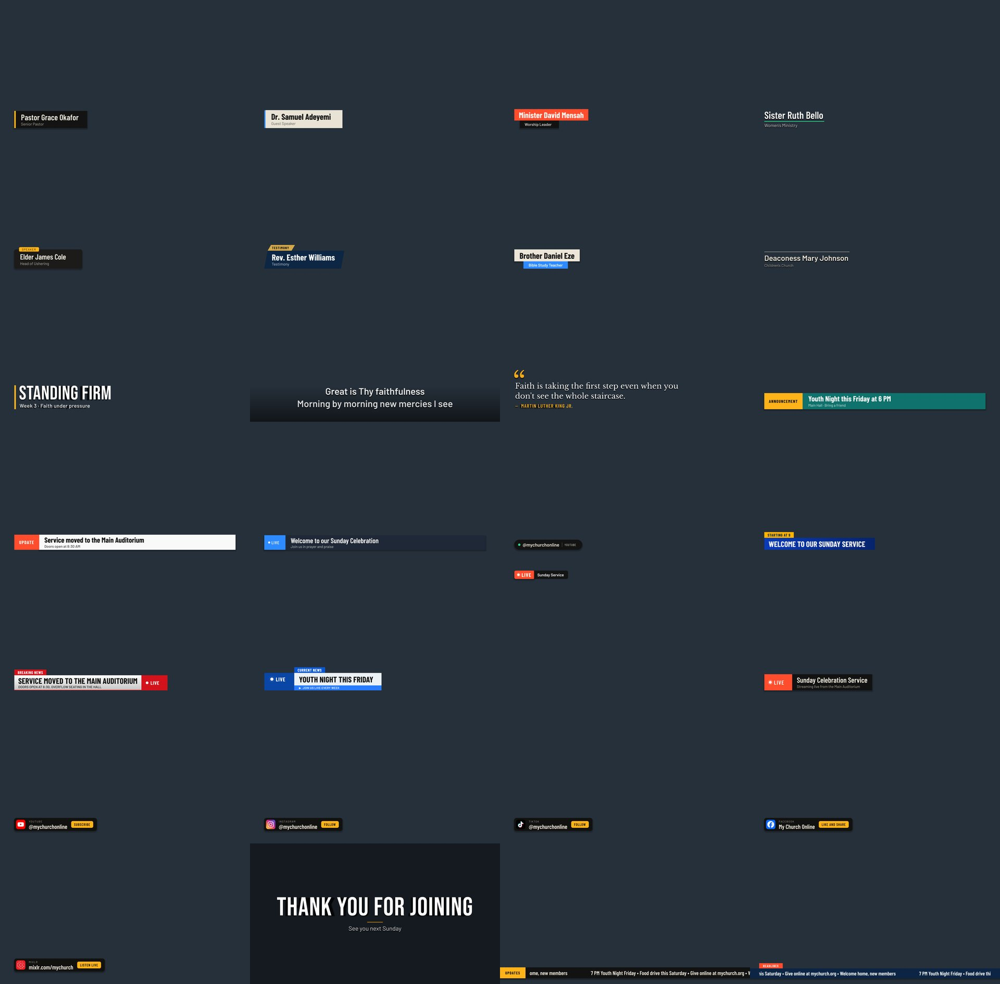

# Laycue

Six small OBS plugins that share one look. Install any one, or all six.

| Plugin | What it does for you | Panel in OBS |
|---|---|---|
| **Laycue Scenes** | One-button scene switching, layouts, rules that stop overlays colliding, cameras that fit into frame graphics | Docks > Laycue |
| **Laycue Titles** | 75 broadcast-style lower thirds, live badges, social cards and scrolling tickers, shown live from OBS; make your own | Docks > Laycue Titles |
| **Laycue Clock** | Countdowns, count-ups and counting to a time of day, in 8 designs, over video or on a background | Docks > Laycue Clock |
| **Laycue Network** | Tests your upload, recommends a bitrate, watches the stream live, can lower and raise the bitrate for you, reports after each stream | Docks > Laycue Network |
| **Laycue Scripture** | Type Book / Chapter / Verse and the verse goes on screen with its reference, as you type | Docks > Laycue Scripture |
| **Laycue Lyrics** | Song words two lines at a time: search by name or first line, grouped parts, move with keys or taps | Docks > Laycue Lyrics |

All six are native OBS plugins: no browser source, no web server, no account. Anything automatic is off until you turn it on. See [`docs/PACK.md`](docs/PACK.md) for what the pack is and why, the [`docs/`](docs/) folder for how each plugin works, [`docs/transitions.md`](docs/transitions.md) for Go Live's branded transitions, and [`docs/UPDATES.md`](docs/UPDATES.md) for how the panels update themselves. How it is built: [`CLAUDE.md`](CLAUDE.md); the original Scenes product definition: [`PRD.md`](PRD.md).

**Status:** working beta. Scenes and Titles are tested in real OBS. Network is tested in real OBS against a local test server (speed test, live monitor, auto-adjust, report); it has not yet met a real streaming platform.

**Requires:** OBS Studio 31 or newer.

## Getting a build

Installers live on this repository's **Releases** page: use the newest one, and the asset for your system
- Windows: `laycue-…-windows-x64-…` (the installer has a tick box for each plugin)
- macOS: `laycue-…-macos-universal-…`
- Linux: `laycue-…-ubuntu-24.04-x86_64-…` (not the `-dbgsym` or `-sources` ones)

Once installed, the panels keep themselves current with **Check for updates** — on Windows **Install when I close OBS**
even runs the installer by itself, after OBS quits. Every push to GitHub also builds all three systems as **Actions**
artifacts, for testing changes before they become a release.

## Installing

Close OBS first.

**Windows**
1. Unzip the download and double-click `laycue-…-windows-x64-Installer.exe`.
2. If Windows shows a blue "Windows protected your PC" box, click **More info**, then **Run anyway**. This appears because the beta isn't code-signed yet.
3. Click **Yes** when Windows asks for permission, then **Next → Install → Finish**. If OBS is open, the installer offers to close it.
4. To remove Laycue later: Windows **Settings → Apps → Installed apps → Laycue for OBS Studio (Scenes, Titles, Clock, Network, Scripture, Lyrics) → Uninstall**.

The download also contains a plain zip (`laycue-…-windows-x64.zip`) for manual installs: copy the folders of the plugins you want (`laycue-scenes`, `laycue-titles`, `laycue-clock`, `laycue-network`, `laycue-scripture`, `laycue-lyrics`) into `C:\ProgramData\obs-studio\plugins\`.

**macOS**
1. Unzip the download and double-click the `.pkg` installer.
2. macOS will warn that it's from an unidentified developer, because the beta isn't code-signed. Right-click the `.pkg` → **Open** → **Open**.

**Linux (Ubuntu 24.04)**
1. Unzip the download and install the `.deb`: `sudo apt install ./laycue-…-x86_64-linux-gnu.deb`

## Opening the panel

1. Start OBS.
2. In the top menu, click **Docks** and pick **Laycue**, **Laycue Titles**, **Laycue Clock**, **Laycue Network**, **Laycue Scripture** or **Laycue Lyrics**.
3. The Laycue panel appears floating. Drag it by its title bar to wherever you like, for example next to Sources. OBS remembers where you put it.

To check that it loaded: **Help** → **Log Files** → **View Current Log**, and search for `[laycue] plugin loaded successfully`.

## Using Laycue

1. **Normal or Studio.** In **Settings → Working with OBS**, **Normal** sends a scene straight to the stream. **Studio** turns on OBS's Studio Mode, and Laycue runs Preview (Up next) and Program (Live). Turn on **Laycue view** there to hide OBS's own Preview and Program screens so Laycue fills the window (turn it off to bring them back; you need them to drag things around on the canvas).
2. **Shots.** Tap a scene to get it ready (Up next). Press **Go Live** (uses your OBS transition) or **Cut** (instant). Nothing changes on the stream until you do. Space also presses Go Live while the panel is selected. The transition Go Live uses is picked under the buttons (**Transition: … ▾**) — including nine that Laycue adds itself: see [`docs/transitions.md`](docs/transitions.md).
3. **Overlays.** Open the **Overlays** tab → **Set up overlays**. Label your sources (right-click one, or press **Auto-label**). Overlays that cover the same part of the screen replace each other; change that under **Overlay rules**.
4. **Layouts.** Open **Layouts** → **New layout** to put things on screen together: pick a shape (side by side, big and small, picture in picture, top and bottom, four squares, full screen), choose what goes in each part, name it. Laycue builds a scene for it; tap it and **Go Live**.
5. **Pushbacks.** Open **Layouts** → **Add pushback**. Choose the graphic (an image file, or a source already in OBS), say if its window is see-through or a colour, choose which cameras can show inside, and name it. Laycue makes one scene for it. Tap it, **Go Live**, then use the camera buttons under Live to switch the camera inside the window. **Unpin** goes back to what was on before.
6. **Settings** (the gear): cut or fade inside pushbacks, large buttons for a touchscreen, tips, **profiles** (save your setup under a name and load it in another scene collection), and **Lock setup for the service**.
7. **Hotkeys.** OBS **Settings → Hotkeys**, search for "Laycue": Go Live, Cut, Unpin, next/previous camera, clear Up next.

Your labels, rules, pushbacks and settings are saved with the OBS scene collection.

## Developing

See the **Commands** section of [`CLAUDE.md`](CLAUDE.md).
