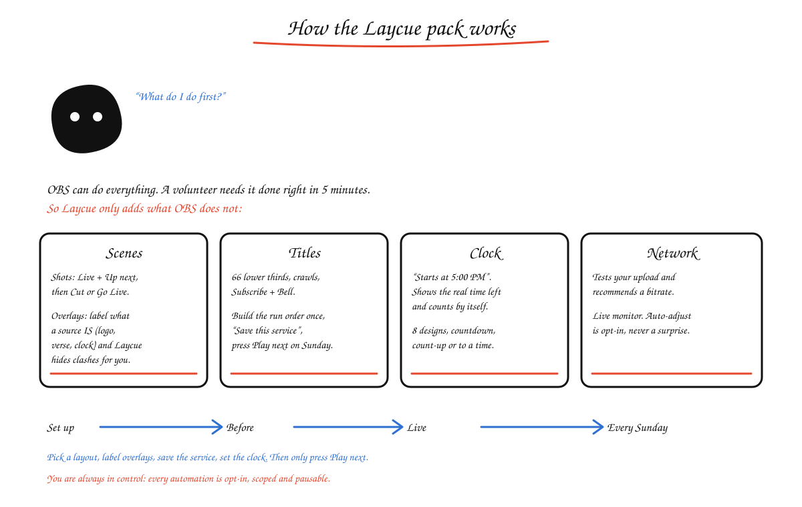

# The Laycue pack: product definition (v1.0)

Six OBS plugins that are installed (and removed) separately. They share one look and feel and
nothing else at run time, so any one of them can be used alone.

| Plugin | Job | Folder |
|---|---|---|
| **Laycue Scenes** | Run scenes and layers without mistakes: Go Live, overlay rules, layouts, pushbacks | `plugins/scenes` |
| **Laycue Titles** | Broadcast-quality lower thirds, live badges, social cards and tickers, made inside OBS | `plugins/titles` |
| **Laycue Network** | Choose the right bitrate, watch the connection live, protect the stream | `plugins/network` |
| **Laycue Clock** | Countdowns and timers on screen, over video or on a background | `plugins/clock` (see `clock.md`) |
| **Laycue Scripture** | Type a verse the EasyWorship way and show it; versions from XML files | `plugins/scripture` (see `scripture.md`) |
| **Laycue Lyrics** | Type a song's name and show it two lines at a time; write, edit, import songs | `plugins/lyrics` (see `lyrics.md`) |

## What problem each one solves (and what OBS and others already do)

Research notes are from public sources read on 2026-10-04: the OBS forum, OBS's own commit history, plugin
reviews and church-streaming guides.

### Scenes
- **Problem:** volunteers run OBS; one wrong click or two overlays on top of each other ruins the service.
  OBS "does the least hand-holding" (church-streaming guides).
- **OBS has:** scenes, Studio Mode, hotkeys. **Plugins have:** Advanced Scene Switcher (automation by rules),
  Move (transitions).
- **Laycue adds (nobody does this together):** overlay rules by *label and position*, camera-in-a-frame
  "pushbacks" with live camera switching, one-click layouts, Studio Mode takeover, a volunteer lock.

### Titles
- **Problem (demand evidence):** "it is difficult to have lower third graphics controlled independently
  from camera scenes" (OBS forum). Churches work around it with Stream Deck + browser sources + separate
  graphics apps. Speaker names are needed every week.
- **OBS has:** text sources and a browser source. No lower-third system, no animation, no templates.
- **Others:** browser-source based tools (HTML/CSS), web servers inside OBS (Smart Lower Thirds), a paid
  web app (StreamSlayers). All need a browser source or a web server.
- **Laycue adds:** a *native* OBS source (no browser, no web server, no network), 68 designed templates
  that look broadcast-grade, a custom template editor, scrolling tickers, live and social cards with
  auto-fit text, show/hide with animation from the dock or hotkeys, a queue ("next up"), and one click to add
  the title layer to every scene so it stays on air while cameras switch.

### Network
- **Problem (demand evidence):** "good upload speed but bitrate continues to drop", "good internet speeds,
  bad bit rate", dropped frames that trigger platform quality warnings. People guess a bitrate.
- **OBS has:** *Dynamic Bitrate* (Settings > Advanced): lowers bitrate when congested and creeps back up
  slowly, with no visibility and no recommendation; the Auto-Configuration Wizard (one-time estimate, only
  for some services).
- **Laycue adds:** a pre-flight upload test with a plain recommendation (bitrate, resolution, fps), a live
  health score with history, an *adaptive* mode with your own floor and ceiling and a visible reason for every
  change, alerts before viewers notice, and an after-stream report. We do **not** pretend OBS has nothing:
  Laycue Network uses the same encoder-update mechanism OBS's own dynamic bitrate uses, and adds the
  parts it lacks.

## Where existing tools fall short, and how the pack uses it

Sources: OBS forum threads and issues #8451, #9667, #12235, #12982, #5933 (GitHub), plugin project pages.

| Existing tool | Documented weakness | What Laycue does instead |
|---|---|---|
| Browser-source lower thirds (HTML, Smart Lower Thirds, StreamElements, Animated Lower Thirds) | CEF uses a lot of CPU (reports of 50-60% of a core), stutters when OBS loses focus (Windows Efficiency Mode), fonts go missing, needs a local web server or port, "lower third not showing" is a common support thread | Titles is a **native source**: no browser engine, no server, no ports; fonts are bundled; an idle title costs nothing; it never depends on window focus |
| OBS Dynamic Bitrate | RTMP only (not SRT or WHIP); can fall to ~400 kbps and take 5-10 minutes to recover; any manual change is undone; can loop (raise, fail to reconfigure, drop); AMF encoder not supported | Network's controller is **protocol-independent** (it drives the encoder), recovers on a **bounded, visible ramp** you choose (default about 60 s), never goes under **your floor**, remembers the bitrate you set as the ceiling, and **stops and says so** if the encoder refuses a change instead of looping |
| Advanced Scene Switcher | Powerful but hard to learn, outdated docs, macros that fire together cause flicker and need hand-made cooldowns; no preview of what will happen | Scenes has few rules, each shown in plain words with the spot it covers; changes Laycue causes are never re-triggered; a lock mode for volunteers |
| Hand-made lower thirds from OBS text sources | No animation, no queue, change per scene | One title layer, animated in and out, queued, added to every scene on request |
| Auto-Configuration Wizard | One-time, some services only, not live | Pre-flight test any time, plus a live health score |

## Features chosen because people ask for them (not only what you listed)

Ranked by evidence of demand and by how much they reduce on-air mistakes.

1. Lower thirds that stay up while cameras switch (Titles: one-click "add to every scene").
2. Control from a Stream Deck or any hotkey box (every plugin registers OBS hotkeys; Stream Deck can press them).
3. Song-line titles and name bars with automatic text fitting (Titles).
4. A queue: prepare the next title while one is on air (Titles).
5. A pre-service checklist: "is the stream ready?" (Network pre-flight; Scenes lock).
6. Volunteer mode: lock setup so nothing gets rearranged mid-service (Scenes, already built).
7. Early warning instead of after-the-fact dropped frames (Network health score + alert).
8. After-stream report to learn from (Network).

Not in v1 (said honestly): multistreaming, chat/alerts, vertical canvas, audio tools. Other plugins own these.

## MVP definition ("viable" means these work in real OBS)

- **Scenes:** everything already built and tested (Shots, Go Live/Cut, overlays + rules, layouts, pushbacks, Studio Mode, Laycue view, lock, profiles, hotkeys).
- **Titles:** a `Laycue Title` source; 20 templates; custom template editor; ticker; show/hide with
  animation; queue; hotkeys; add to all scenes; designed preview gallery; unit-tested timeline maths.
- **Network:** recommender + controller as tested pure logic; live sampler from the real stream output;
  upload test; health score + charts; adaptive mode (live encoder bitrate changes); after-stream report.

## Architecture decisions

- One repository, one CMake project, **three MODULE targets** and a static `laycue-common` library (brand tokens,
  controls, fonts). Statically linked into each module: no shared DLLs, no version conflicts, install any subset.
- Pure logic in `core/` of each plugin, unit tested without OBS. OBS-touching code is isolated in `obs/`.
- Titles render with Qt's painter into a small texture region (bottom third / ticker bar) and are uploaded to the
  GPU; animation runs only while moving, so a title that is simply on air costs nothing.
- Network measures what OBS exposes (bytes sent, dropped frames, congestion) plus an opt-in upload test.
  The test sends random bytes only when the operator clicks Test, to an endpoint they can change.
- Installer: Windows setup with one checkbox per plugin; macOS/Linux packages carry all three.

## Success criteria

- A volunteer can show a speaker name without touching a scene.
- A streamer on a bad connection ends a one-hour stream with fewer dropped frames than with OBS dynamic bitrate alone,
  and can see why bitrate changed.
- Each plugin works installed alone.

Updates (a "Check for updates" button in each plugin, published through a small public releases repo): see `UPDATES.md`.

## The Laycue menu

Every plugin adds its own entry to a **Laycue** menu in OBS's menu bar (between Tools and Help): Clock, Network, Scenes, Titles. Click an entry to show or hide that panel; a tick means it is open. Whichever plugin loads first makes the menu, so with only some installed the menu shows only those. The code is `plugins/common/src/ui/laycue-menu.*`.

## One idea of "overlay"

An overlay is anything that sits on top of the picture: scripture, lyrics, a name bar, a logo, a title, a clock. Laycue Scenes
holds the one list of them (the Overlays tab):
- **Laycue Titles and Laycue Clock layers are overlays automatically.** They get their label by themselves.
- **Auto-label** looks at each other source: its name, what it is, whether its picture has no background or a green screen,
  and where it sits. It never labels a camera or a capture, and says why under each name ("see-through picture").
- **Show in every scene** (right-click an overlay in Set up overlays): Laycue keeps that source in every scene, also in scenes
  made later. Unpinning stops Laycue adding it; it does not remove it from scenes that have it.
- The Titles panel's own "Add to all scenes" does the same one-time job for a title layer when the Scenes plugin is not installed.

## Layout backgrounds

When you make a layout (Scenes → Layouts), **Background picture** is optional. With one, the picture fills the canvas behind the layout, each part gets a space around it, and Laycue draws a **gold or silver frame** around every part. It picks the metal from the picture's average colour: gold on blues, purples, greens and light pictures; silver on warm yellow and orange ones (where gold would disappear) and on dark grey ones. The frame is always metal, whatever the picture looks like. The code is `core/frame-style.*` (the choice, tested) and `features/layout-frame.*` (the drawing).

## Changing a layout

- **Swap or reorder:** the ↑ and ↓ beside each part move its source up or down, trading places with the next part. The parts keep their shape; the sources move.
- **Room for each part:** for two-part splits (Side by side, Big and small, Top and bottom), **−** and **+** change how much room the first part gets, from 20% to 80% in 5% steps.
- **Edit a layout you already made:** right-click its card under **Your layouts** and choose **Edit layout…**. Laycue changes the same scene in place. Frames are redrawn to the new sizes.

## Panel switcher

The names at the top of every Laycue panel (Clock, Network, Scenes, Titles) swap the panel in place: the one you pick takes this panel's spot and this one closes, so no new window or tab appears. A panel that is already open (for example one you dragged out) just comes forward.
